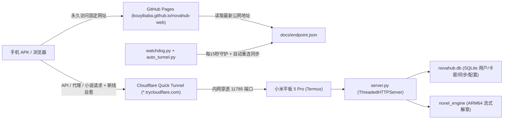

# NovaHub · 星隅 — 完整项目说明与运维手册

**当前源码版本**：网页与 Android 壳 `v2.4.3`；线上实际版本以发布清单为准，本地改动不代表已部署。
**产品定位**：私人影视放映、黑胶无损音乐与在线流式小说三合一终端（支持固定入口网页、可热更新 Android APK、站长卡密后台与小米平板后端）。

---

## 一、核心访问入口汇总

| 用途 | 访问地址 / 位置 | 说明 |
|---|---|---|
| **永久固定前台** | https://kouyibaba.github.io/novahub-web/ | 手机/电脑/APK 统一入口，支持热更新，不随平板隧道更换而失效 |
| **永久固定站长后台** | https://kouyibaba.github.io/novahub-web/admin.html | 批量发卡、核销台账、动态广告赞助位、改密管理（自动通过 `endpoint.json` 路由至平板后端） |
| **GitHub 开源仓库** | https://github.com/kouyibaba/novahub-web | `main` 分支 `/docs` 托管 GitHub Pages 固定前端 |
| **最新 APK 编译下载** | https://kouyibaba.github.io/novahub-web/apk/novahub-latest.apk | 永久下载地址；实际已发布版本与文件大小以 `apk-version.json` 为准，备用包见仓库 Releases |
| **APK 自动更新清单** | https://kouyibaba.github.io/novahub-web/apk-version.json | 供客户端自动比对 `versionCode` 与 SHA-256 校验 |
| **APK 编译工作流总表** | https://github.com/kouyibaba/novahub-web/actions/workflows/build-apk.yml | 每次更新 `android-app/` 后自动云端编译 |

---

## 二、系统架构与工作原理

采用 **「GitHub Pages 永久固定前端 + 动态节点寻址 + 小米平板常驻后端 + Cloudflare 免费穿透」** 的零成本架构：



### 关键机制说明
1. **断线自动自愈**：`docs/index.html` 在请求 `/api/*`、`/kw`、`/proxy` 遇到 `502`/`503`/`530` 或网络异常时，会自动重新请求 `docs/endpoint.json?t=时间戳` 获取平板最新隧道并重试，用户在前端「我的」页面也可查看节点实时延迟或一键「刷新节点」。
2. **后台定时嗅探**：`server.py` 启动 8 秒后首次并发探测公共影视源可用性与延迟，此后每 6 小时巡检一次，通过 `/api/sources/live` 自动下发给前端。
3. **热更新与自更新 APK 壳**：原生 WebView 使用 `LOAD_DEFAULT` 缓存静态资源，入口带时间戳，JS/CSS 用版本参数更新。新版界面发布时必须同时更新资源版本参数。正式 APK 使用固定签名，构建缺少签名凭证或验签失败时停止发布；客户端包含媒体通知、亮度音量桥接及覆盖更新。

---

## 三、仓库目录与核心文件说明

| 路径 | 职责说明 |
|---|---|
| `docs/index.html`、`docs/style.css`、`docs/app.js`、`docs/admin.html` | GitHub Pages 托管的固定前端与后台页面，含网关拦截与断线自愈（根目录同名文件与之保持一致） |
| `docs/endpoint.json` | 由平板 `auto_tunnel.py` 自动维护的最新 Cloudflare 公网隧道地址（**手工提交代码时切勿覆盖此文件**） |
| `server.py` | 多线程网关服务端（`11785` 端口）：静态资源、防 SSRF 同源 `/proxy`（已放行 `kouyibaba.github.io`）、`/kw` 音乐接口、`/api/novel/*` 小说按章解锁与后台预取 4 章、用户/卡密/同步/后台接口、6 小时定时影视源嗅探 |
| `db.py` | 基于 Python 标准库 `sqlite3` 的数据层：PBKDF2 密码哈希、HMAC-SHA256 Token、原子卡密核销、跨端同步 `user_sync` 表、站点动态配置 `site_config` |
| `admin_cli.py` | 命令行发卡、开关广告位与统计脚本（本地/平板 SSH 均可用） |
| `android-app/` | Android 原生 WebView 工程（暗金四芒星图标、全屏横屏控制及原生媒体通知） |
| `.github/workflows/build-apk.yml` | GitHub Actions 自动编译与打包 `NovaHub-Android-APK` 工作流 |
| `ops/auto_tunnel.py` | 已纳入版本管理的隧道守护脚本：429 冷却 180 秒，拒绝发布空地址，重试更新 `docs/endpoint.json`；`backup/` 为本地兼容副本 |
| `ops/watchdog.py` | 已纳入版本管理的看门狗（`fcntl.flock` 单例锁）：每 15 秒巡检、约每 60 秒公网探活、日志 5MB 截断 |
| `safe_http.py`、`source_probe.py`、`sources.json` | 证书验证、DNS 地址固定及逐跳代理校验；影视源并发探测与缓存 |
| `backup_db.py` | SQLite 在线一致性备份、完整性检查与最近 14 份保留；后端每日自动运行 |
| `novel_engine/` | 小说本地解码引擎与配置（保留按章缓存 `downloaded_chapters.jsonl`） |

---

## 四、会员分级与商业化后台使用

### 1. 用户端等级差异
| 权益项 | 未登录游客 | 标准免费版（已登录） | Pro 尊享版（兑换卡密） |
|---|---|---|---|
| 浏览与精确搜索 | ✅ | ✅ | ✅ |
| 播放影视 / 歌曲 | 引导 5 秒注册 | ✅ | ✅ |
| 收藏、书架、分组云同步 | 仅本地 | ✅ 自动存库与恢复 | ✅ 多端自动云同步 |
| 前台原生赞助广告位 | 展示 | 展示 | **全局纯净免广告** |
| 音乐音质 | — | 锁定 128k / 192k | **解锁极高 320k / FLAC 无损** |

### 2. 站长后台（`admin.html`）操作指南
1. 打开 **https://kouyibaba.github.io/novahub-web/admin.html**（需使用你已修改过的管理员密码登录，新库初始为 `NovaAdmin888`）。
2. **批量发卡**：选择预设天数（或自定义输入如 `7` 天体验卡、`30` 天月卡、`90` 天季卡、`365` 天年卡），填好数量与备注，点击 **「立即生成卡密」** 后可一键全部复制。
3. **卡密台账**：支持筛选「全部 / 未使用 / 已核销」，实时追踪核销人与时间。
4. **动态赞助位**：随时开关前台赞助卡片并更新文案、按钮文字与跳转链接（Pro 会员自动隐藏）。
5. **命令行辅助发卡**（可选，在平板 `~/novahub` 目录下执行）：
   ```bash
   python3 admin_cli.py gen-codes 10 30 --note "月卡批次"
   python3 admin_cli.py stats
   ```

---

## 五、小米平板 5 Pro（Termux）运维与两层守护手册

### 1. 已部署的防杀与看门狗机制
- **系统级防杀（已通过 ADB 写入）**：
  - 关闭 Android 13 幻影进程监控（`settings_enable_monitor_phantom_procs = false`）；
  - 最大子进程上限调整为 `2147483647`；
  - `com.termux` 与 `com.termux.widget` 已加入电池 Doze 白名单。
- **看门狗单例守护（`~/novahub/watchdog.py`）**：
  - 每 15 秒检测一次 `sshd`（8022）、`server.py`（`http://127.0.0.1:11785/api/config`）与 `cloudflared`/`auto_tunnel.py`，异常即拉起（不干扰正常在线的隧道）；
  - 自动截断超过 5MB 的 `server.log` / `tunnel.log` / `watchdog.log`；
  - 已配置 `~/.bashrc`（打开 Termux 自检拉起）、`~/.shortcuts/NovaHub守护.sh`（桌面快捷启动）及 `~/.termux/boot/start-novahub.sh`（配合 Termux:Boot 实现重启平板自启）。

### 2. 平板上建议顺手开启的 3 项 MIUI 设置
1. `设置 → 应用设置 → 应用管理 → Termux → 省电策略` 设为 **无限制**。
2. 同页面打开 **自启动**。
3. 打开近期任务列表，长按 **Termux** 卡片点 **🔒 锁定**。

### 3. 电脑通过 USB SSH 维护平板
```powershell
adb forward tcp:8022 tcp:8022
ssh -p 8022 u0_a295@127.0.0.1
```
连接后常用排查命令（在平板 Termux 内执行）：
```bash
pgrep -fa "watchdog.py|server.py|cloudflared|sshd"
tail -n 30 ~/novahub/watchdog.log
tail -n 30 ~/novahub/server.log
curl -s http://127.0.0.1:11785/api/config
```

### 4. 数据库备份与恢复
核心数据在平板 `~/novahub/novahub.db`。后端每日在线备份到 `~/novahub/backups/`，每份完成后检查完整性，保留最近 14 份；也可通过 SSH 手工生成一致性快照后下载：
```powershell
ssh -p 8022 u0_a295@127.0.0.1 "cd ~/novahub && python3 backup_db.py"
# 将上一步返回的快照文件路径填写到 scp，下载已经完成的快照。
scp -P 8022 u0_a295@127.0.0.1:~/novahub/backups/<快照文件名>.db ./backup/
```
不要直接复制在线主库，也不要只执行 checkpoint 后再复制；新的写入仍可能进入 WAL。定期将快照保存到另一台设备，并用副本演练恢复。实际恢复时先停止看门狗和后端、保留原数据库及其 WAL/SHM，再将验证后的快照放到配置的数据库路径，避免旧 WAL 与恢复库混用，最后启动服务并核对账号及卡密数据。

安全更新后须重新登录一次；以后改密或重置密码立即撤销对应旧会话。更新平板时先完整安装 `server.py` 所需模块及 `sources.json`，再按精准 PID 流程重启。`bash ops/install_termux.sh` 负责安装，不会自动重启。

---

## 六、常见故障速查

| 现象 | 原因 | 处理方法 |
|---|---|---|
| 手机提示节点连接异常或 `502`/`530` | 平板切换网络或隧道重连中 | 等待约 30 秒让看门狗重建并刷新 `endpoint.json`，然后在前端「我的」点击 **刷新节点** |
| GitHub 日志提示 `429` | 短时间重启隧道次数过多 | 无需人工干预，`auto_tunnel.py` 会自动冷却 180 秒后重连 |
| 前端改了界面但手机没变化 | 浏览器/WebView 缓存未清 | 强刷网页或划掉手机 APK 后台重开，在「我的」核对版本号是否更新 |
| 影视/歌曲跨端未恢复 | 原设备收藏时尚未备份到库 | 在保留收藏的设备上登录同一账号，点「我的 → 云端备份」，再在新设备点「云端恢复」 |
